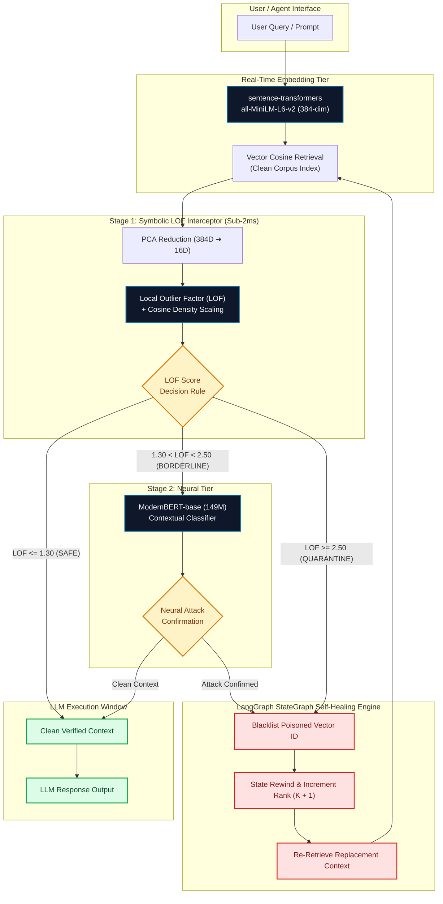

# 📐 Vector-Shield Finalized System Architecture & Methodology

## 1. System Architecture Flowchart (Mermaid)

---

## 2. Step-by-Step Architecture Explanation

1. **User Query Ingestion**: The user or autonomous agent submits a prompt or retrieval query.
2. **Real-Time Vector Encoding**: The query string is converted into a 384-dimensional unit vector tensor using `sentence-transformers` (`all-MiniLM-L6-v2`).
3. **Cosine Vector Retrieval**: Top-K candidate document chunks are retrieved from the enterprise vector database via cosine similarity.
4. **Stage 1 (Symbolic LOF Interceptor)**:
   - High-dimensional vectors are reduced to 16D via Principal Component Analysis (PCA) to prevent distance concentration.
   - Local Outlier Factor (LOF) calculates local reachability density ratios.
   - Cosine Density Scaling ($\text{LOF}_{\text{scaled}} = \text{LOF}_k \cdot (\text{cos\_dist} / \text{baseline})^{1.2}$) non-linearly amplifies geometric deviations from clean domain centroids.
5. **Soft-Margin Decision Rules**:
   - $\text{LOF} \le 1.30 \implies \mathbf{SAFE}$: Passed directly to the LLM context window.
   - $1.30 < \text{LOF} < 2.50 \implies \mathbf{BORDERLINE}$: Routed to Stage 2 ModernBERT for deep contextual inspection.
   - $\text{LOF} \ge 2.50 \implies \mathbf{QUARANTINE}$: Instantly dropped and sent to the self-healing engine.
6. **LangGraph StateGraph Self-Healing Engine**:
   - When a vector is quarantined, the compiled `StateGraph` rewinds state, appends the vector ID to an active blacklist, increments retrieval rank ($K+1$), and re-queries clean replacement context.
7. **LLM Execution Window**: Clean, unpoisoned context is presented to the LLM agent to generate verified responses.
